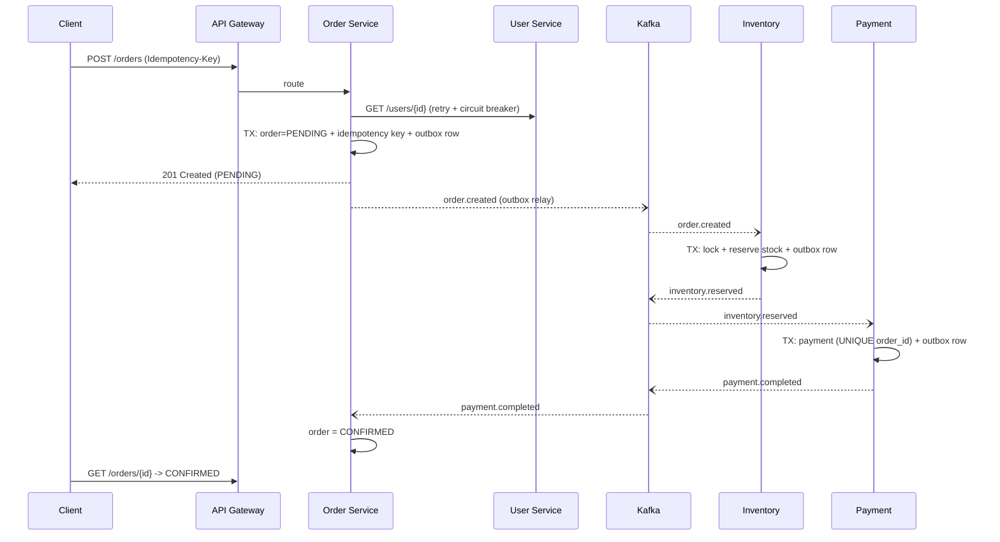

# Enterprise Order System (Spring Boot + Kafka)

Microservices: **User, Order, Payment, Inventory** behind an **API Gateway**, event-driven over **Kafka**
(choreographed **saga** with compensation). Java 17, Spring Boot 3.3, Spring Cloud Gateway, Resilience4j.

## Architecture

```
                     ┌──────────────┐
 client ───────────► │ API Gateway  │ :8080  routing, per-route circuit breaker, GET retry w/ backoff
                     └──┬───┬───┬───┬┘
          /users ───────┘   │   │   └─────── /inventory
                  /orders ──┘   └── /payments
        ┌───────────┐ ┌───────────┐ ┌────────────┐ ┌──────────────┐
        │ User :8081│ │Order :8082│ │Payment:8083│ │Inventory:8084│   each service owns its own DB
        └───────────┘ └─────┬─────┘ └─────┬──────┘ └──────┬───────┘   (H2 here, Postgres in prod)
              ▲  REST       │  outbox ──► Kafka ◄── outbox │
              └─ (retry + CB)└────────────────────────────┘
```

| Service   | Port | Owns                              | Publishes                                   | Consumes                                          |
|-----------|------|-----------------------------------|---------------------------------------------|---------------------------------------------------|
| gateway   | 8080 | routing                           | –                                           | –                                                 |
| user      | 8081 | `users`                           | –                                           | –                                                 |
| order     | 8082 | `orders`, `order_items`, `idempotency_keys` | `order.created`, `order.cancelled` | `payment.completed`, `payment.failed`, `inventory.rejected` |
| payment   | 8083 | `payments`                        | `payment.completed`, `payment.failed`       | `inventory.reserved`                              |
| inventory | 8084 | `stock_items`, `stock_reservations` | `inventory.reserved`, `inventory.rejected` | `order.created`, `order.cancelled`                |

Every service that uses Kafka also has `outbox_events` and `processed_events` tables (module `common`).

## Sequence flow

The brief's flow is `Order → Kafka → Payment → Kafka → Order`. Because the system also has an Inventory service,
stock is reserved *before* charging so we never charge for something we cannot ship:



### Saga rollback (compensation)

| Failure                         | What happens                                                                                   |
|---------------------------------|------------------------------------------------------------------------------------------------|
| Out of stock / unknown SKU      | Inventory emits `inventory.rejected` → Order = `CANCELLED` (nothing to undo)                   |
| Payment declined                | Payment emits `payment.failed` → Order = `CANCELLED` + emits `order.cancelled` → Inventory **releases** the reservation |
| Nothing happens for 15 min      | Order's timeout job cancels the `PENDING` order and emits `order.cancelled` (stock released)    |

## API contracts (via gateway, `http://localhost:8080`)

| Method | Path             | Description                                                                 | Success |
|--------|------------------|-----------------------------------------------------------------------------|---------|
| POST   | `/orders`        | Create order. **Header `Idempotency-Key` required.** Body: `{userId, items:[{sku, quantity, unitPrice}]}` | `201` (new) / `200` (replay, `Idempotent-Replayed: true`) |
| GET    | `/orders/{id}`   | Fetch order and its status (`PENDING`, `CONFIRMED`, `CANCELLED`)            | `200` / `404` |
| POST   | `/payments`      | Process a payment `{orderId, amount}`. Idempotent per `orderId`.            | `201` / `200` (already paid) |
| GET    | `/payments/{id}`, `/payments/order/{orderId}` | Fetch payment                                   | `200` / `404` |
| POST/GET | `/users`, `/users/{id}` | Create / fetch user (user `1` is seeded)                              | |
| GET/PUT  | `/inventory/{sku}` | Read / set stock (`SKU-1`=100, `SKU-2`=50, `SKU-3`=5 seeded)              | |

Errors: `409 IDEMPOTENCY_KEY_REUSED` (same key, different body), `422 USER_NOT_FOUND`,
`503 DEPENDENCY_UNAVAILABLE` (+ `Retry-After`) when the User service is down / circuit open, `400` on validation.

## DB schema

```
Orders(id PK, user_id, status, total, failure_reason, created_at, version)      -- spec: id, user_id, status, total
Order_items(order_id FK, sku, quantity, unit_price)
Idempotency_keys(idem_key PK, request_hash, order_id, created_at)
Payments(id PK, order_id UNIQUE, status, amount, failure_reason, created_at)    -- spec: id, order_id, status
Stock_items(sku PK, available)            Stock_reservations(id PK, order_id, sku, quantity, released)
Outbox_events(id PK, topic, message_key, payload, created_at, published)        -- every Kafka-using service
Processed_events(id PK, processed_at)                                           -- every Kafka-consuming service
Users(id PK, name, email UNIQUE)
```
Extra columns beyond the brief's minimum are there to make idempotency, optimistic locking and compensation possible.

## Failure handling

| Mechanism                  | Where                                   | Details                                                                 |
|----------------------------|-----------------------------------------|-------------------------------------------------------------------------|
| Retry, exponential backoff | Order → User REST call                  | Resilience4j: 4 attempts, 200ms → 400ms → 800ms; 404s are never retried |
| Retry, exponential backoff | Kafka consumers                         | 5 retries, 0.5s → 8s; then the record goes to `<topic>.DLT`; malformed payloads skip retries |
| Retry, exponential backoff | Gateway                                 | GET only (POSTs are made safe by idempotency keys instead)              |
| Circuit breaker            | Order → User; every gateway route       | Opens at 50% failures (min 5 calls), 10s open, then half-open probes; fails fast with `503` |
| Timeouts                   | REST client, gateway, Kafka producer    | Nothing waits forever                                                   |
| Saga rollback              | Order / Inventory / Payment             | Compensating events as in the table above + 15-min timeout              |
| Transactional outbox       | all publishers                          | DB commit and "event to send" are atomic                                |

## Review questions

### 1. How will you handle duplicate orders?
`POST /orders` requires an `Idempotency-Key`. The service stores `(userId:key) → orderId` plus a SHA-256 of the request
in `idempotency_keys`, **in the same transaction** that creates the order.
* Retry with the same key + body → the original order is returned (`200`, `Idempotent-Replayed: true`), no second order.
* Same key + different body → `409`.
* Two identical requests at the same instant → both pass the lookup, but the primary key lets exactly one commit;
  the loser's transaction rolls back (order and outbox row included) and it returns the winner's order.

### 2. How do you ensure idempotency?
Idempotency is enforced at every hop, because Kafka is at-least-once:
1. **API** – `Idempotency-Key` as above.
2. **Producer** – transactional outbox (no lost/phantom events) + Kafka idempotent producer (`enable.idempotence`, `acks=all`); keyed by `orderId` so one order's events stay ordered.
3. **Consumers** – an *inbox* (`processed_events`, id = `topic:orderId`) written in the same DB transaction as the effect, so a redelivered event is a no-op. Additionally: Payment has `UNIQUE(order_id)`, state changes are guarded (`only PENDING → X`), and Order uses `@Version` optimistic locking.
4. **Payments** – processing the same order twice returns the existing payment and publishes nothing.

### 3. What happens if Kafka is down?
* **Order creation still succeeds.** The order and its `order.created` outbox row commit in one DB transaction; the client gets `201` with status `PENDING`.
* The **outbox relay** can't publish (producer fails within ~3s because `max.block.ms=3000`), logs a warning and retries every second, in order. When Kafka returns, events flow and the saga continues. Nothing is lost.
* Consumers just stop receiving; they resume from their committed offsets afterwards. Redelivery is safe (see Q2).
* If the outage is long, the **timeout job** cancels stale `PENDING` orders and compensates.
* Operationally: alert on outbox backlog (`published=false` older than N min), consumer lag and DLT depth.

Try it: stop Kafka (`docker compose stop kafka`), create an order (you still get `201`), start Kafka again, and watch the order become `CONFIRMED`.

## Running it

Prerequisites: JDK 17+, Maven 3.9+, Docker.

```bash
docker compose up -d                    # Kafka (KRaft mode) on localhost:9092
mvn clean package -DskipTests           # build all modules

# run each in its own terminal (or from your IDE)
mvn -pl user-service      spring-boot:run
mvn -pl inventory-service spring-boot:run
mvn -pl payment-service   spring-boot:run
mvn -pl order-service     spring-boot:run
mvn -pl api-gateway       spring-boot:run
```
Then use `http/requests.http`. Topics are created on startup.

## Known simplifications (and what you'd do in production)
* H2 in-memory DBs → one PostgreSQL schema/database per service (replace the `h2` dependency and `spring.datasource.*`; use Flyway instead of `ddl-auto`).
* `unitPrice` comes from the client; a real system would price from a catalog service.
* The payment "PSP" is simulated (declines amounts > 5000). Refunds for a payment that completes *after* an order was timed-out are not implemented.
* The outbox relay is single-instance safe; for several instances use `FOR UPDATE SKIP LOCKED` or Debezium.
* Add authentication (JWT at the gateway), distributed tracing (Micrometer + OTel), and a cleanup job for `processed_events`/published outbox rows.
* No automated tests are included yet; a Testcontainers (Kafka + Postgres) suite for the saga paths is the natural next step.
